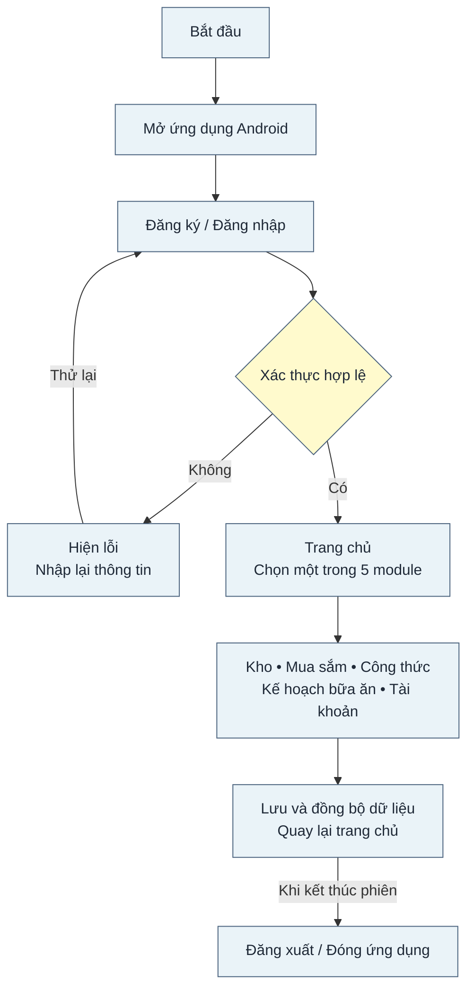
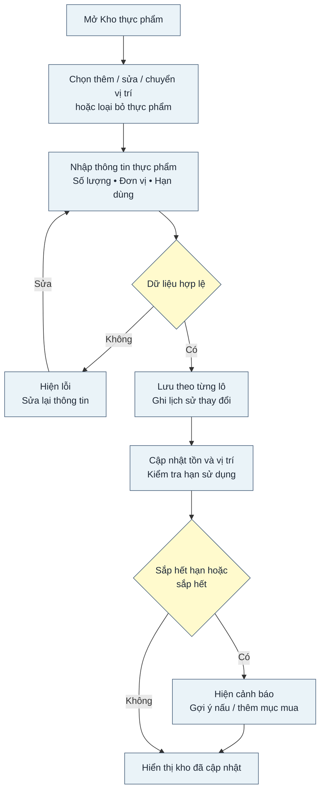
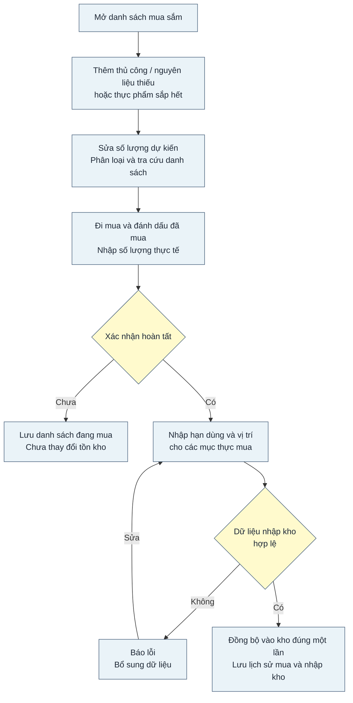
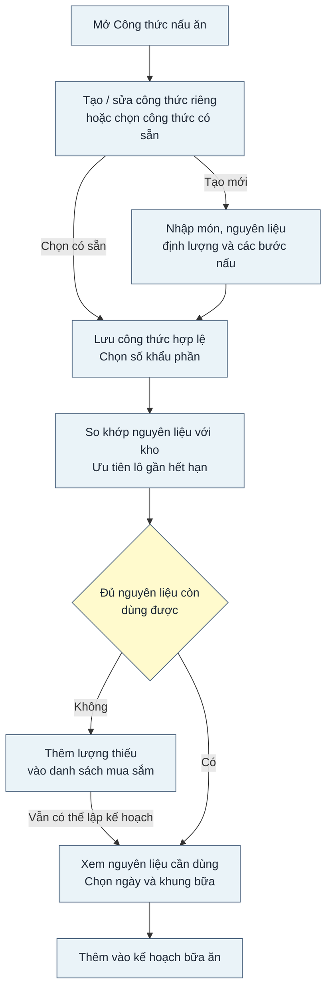
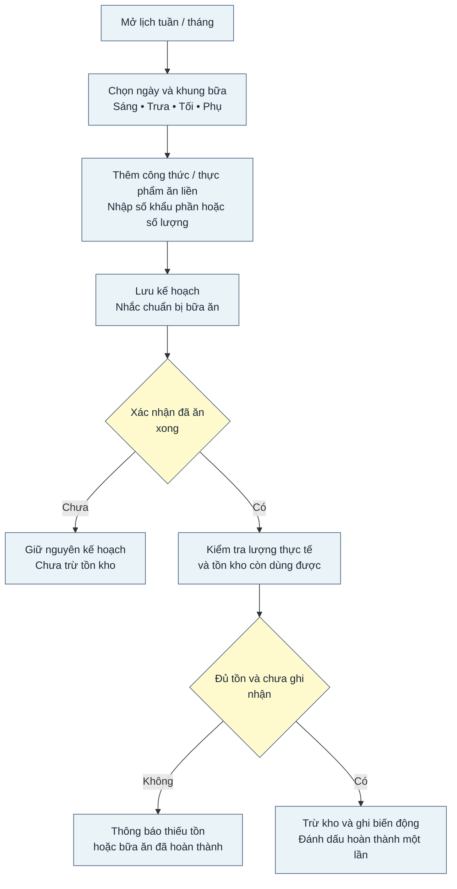
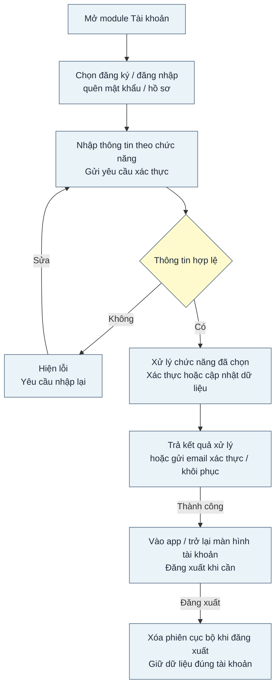
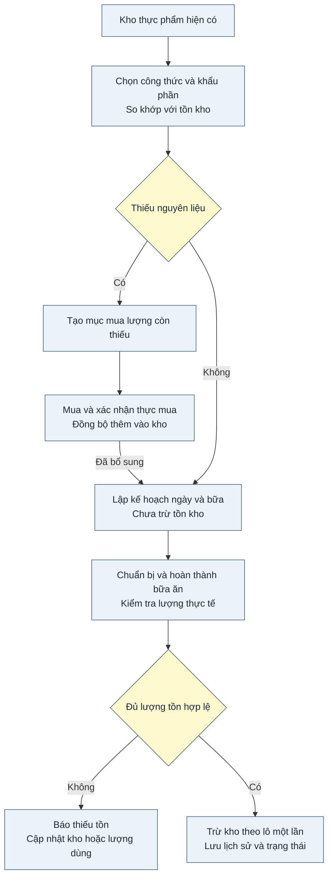

# BỘ MÃ NGUỒN WORKFLOW CHẠY TRÊN DRAW.IO (5 MODULE + TỔNG THỂ + LIÊN KẾT)

Bộ tệp này chuyển đổi đầy đủ **7 sơ đồ workflow** (`wf5_tong_the`, `wf5_kho`, `wf5_mua_sam`, `wf5_cong_thuc`, `wf5_ke_hoach`, `wf5_tai_khoan`, `wf5_lien_ket`) sang mã chuẩn để mở, chỉnh sửa và xuất ảnh trên **draw.io** ([app.diagrams.net](https://app.diagrams.net)).

---

## CÁCH 1 (KHUYÊN DÙNG): MỞ FILE `.drawio` CHUẨN XML (ĐÚNG TỪNG TỌA ĐỘ & MÀU SẮC)

Các file XML `.drawio` đã được xuất sẵn theo đúng tọa độ khối, màu xanh nhạt `#EAF3F8`, hình thoi vàng `#FFFACD` và hướng mũi tên như hình mẫu:

| File | Nội dung |
|---|---|
| `ALL_WORKFLOWS_5_MODULE.drawio` | **File tổng hợp gồm đủ 7 tab** trong một bản vẽ duy nhất |
| `01_wf5_tong_the.drawio` | 1. Quy trình Tổng thể ứng dụng |
| `02_wf5_kho.drawio` | 2. Quy trình Quản lý Kho thực phẩm |
| `03_wf5_mua_sam.drawio` | 3. Quy trình Quản lý Mua sắm |
| `04_wf5_cong_thuc.drawio` | 4. Quy trình Công thức nấu ăn |
| `05_wf5_ke_hoach.drawio` | 5. Quy trình Kế hoạch bữa ăn |
| `06_wf5_tai_khoan.drawio` | 6. Quy trình Tài khoản & Xác thực |
| `07_wf5_lien_ket.drawio` | 7. Quy trình Liên kết giữa các module |

**Thao tác trên draw.io:**
1. Truy cập [app.diagrams.net](https://app.diagrams.net) (hoặc mở Draw.io Desktop).
2. Chọn **File → Open from → Device...** (hoặc kéo thả file `ALL_WORKFLOWS_5_MODULE.drawio` vào khung vẽ).
3. Chuyển đổi giữa 7 workflow ở thanh tab phía dưới; từng khối và mũi tên đều chỉnh sửa độc lập được.

---

## CÁCH 2: DÁN CODE `<mxGraphModel>` VÀO `Extras -> Edit Diagram...`

Nếu bạn đang mở sẵn một trang trắng trên draw.io và muốn dán code XML trực tiếp:
1. Mở một trong các file lẻ `01_wf5_*.drawio` bằng trình soạn thảo text.
2. Copy từ thẻ `<mxGraphModel ...>` đến hết `</mxGraphModel>`.
3. Trên draw.io, vào **Extras → Edit Diagram...**, dán toàn bộ đoạn XML đó vào rồi nhấn **OK**.

---

## CÁCH 3: CODE MERMAID ĐỂ DÁN VÀO `Arrange -> Insert -> Advanced -> Mermaid...`

Nếu bạn muốn dùng trình nhập code text nhanh của draw.io (**Arrange → Insert → Advanced → Mermaid...**), hãy copy từng đoạn code dưới đây dán vào ô nhập và bấm **Insert**:

### 1. Workflow Tổng thể (`wf5_tong_the`)

### 2. Workflow Kho thực phẩm (`wf5_kho`)

### 3. Workflow Mua sắm (`wf5_mua_sam`)

### 4. Workflow Công thức nấu ăn (`wf5_cong_thuc`)

### 5. Workflow Kế hoạch bữa ăn (`wf5_ke_hoach`)

### 6. Workflow Tài khoản (`wf5_tai_khoan`)

### 7. Workflow Liên kết các module (`wf5_lien_ket`)

